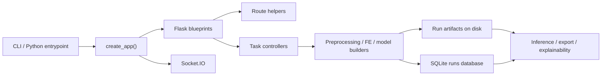
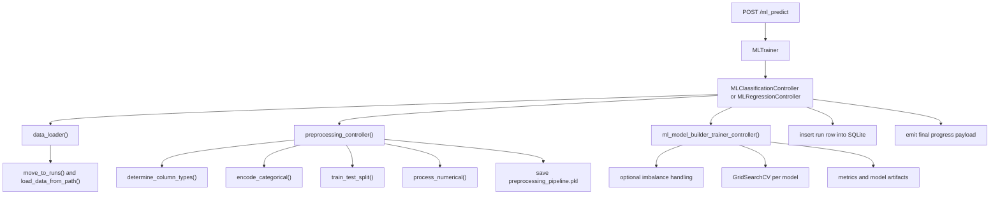
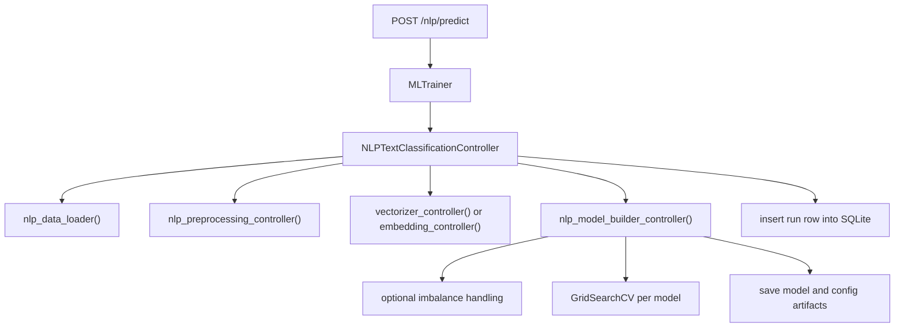
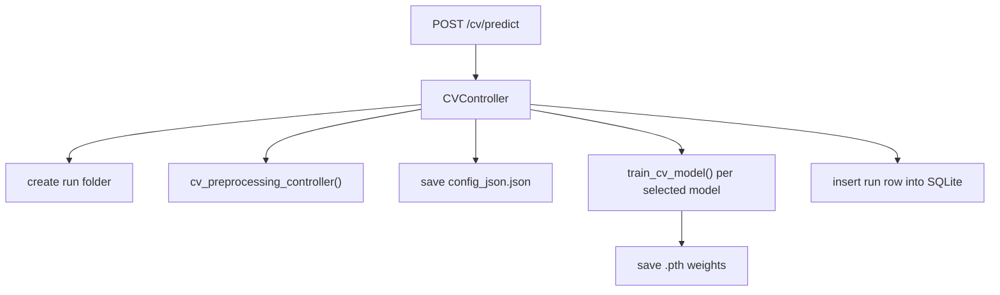

# Easy-ML Developer Guide

## Purpose

This guide explains how the current Easy-ML codebase works so a new contributor can onboard without reverse-engineering the project from scratch.

It is based on the active repository structure as it exists now:

- a modular Flask application created by `easyml.app_factory.create_app`
- task-specific controllers for tabular ML, NLP, and CV
- persisted run artifacts under an external data directory
- a no-build Vue 3 frontend (ES modules) at `easyml/unified_frontend/dist`

It is distributed on PyPI as `easy-ml-studio`; the import package is `easyml` and the CLI is `easy-ml`.

## High-Level Architecture

Easy-ML is best understood as four layers:

1. Entry and app wiring
2. HTTP and WebSocket interface
3. Task-specific pipeline orchestration
4. Persistence and runtime utilities



## What the Package Exposes Publicly

The top-level package intentionally exports a small API (documented for users in `docs/PYTHON_API.md`):

- `easyml.MLTrainer`: train tabular and text runs from Python
- `easyml.load_model(run_id, model_name=None)`: a `Predictor` for any saved run (`easyml/predictor.py`)
- `easyml.retrain(run_id, dataset_path, name=None, models=None, recipe=None)`: a run's settings on new data, optionally cleaned with a data-prep recipe first (`easyml/retraining.py`)
- `easyml.export_run(...)` / `easyml.import_run(..., trusted=True)`: run archives (`easyml/run_archive.py`)
- `easyml.serve(run_id, ...)`: a run as a REST API (`easyml/serving/`)
- `easyml.prep`: data-prep recipes (`Recipe`, `apply`, `profile`, `steps`, `list_recipes`, `delete_recipe`;
  `easyml/prep.py` over `easyml/dataprep/`)

Everything except `MLTrainer` is a lazy wrapper, so `import easyml` never loads torch, spaCy or SHAP
(`tests/test_predictor.py` checks this). Other modules are internal.

## Repository Structure

```text
easyml/
  __init__.py
  app.py
  app_factory.py
  route_helpers.py
  routes_core.py
  routes_cv.py
  routes_frontend.py
  routes_nlp.py
  routes_prep.py
  routes_runs.py
  routes_settings.py
  trainer.py
  predictor.py
  retraining.py
  prep.py
  dataprep/
    engine.py
    profile.py
    recipe.py
    steps.py
  serving/
    docs_page.py
    runner.py
    server.py
  config/
    GLOBAL_VARS.py
    paths.py
  core/
    controllers.py
    eda_generator.py
    evaluator.py
    imbalance_handler.py
    inference.py
    model_builder.py
    pre_processing.py
    xai_explainer.py
  nlp/
    nlp_config.py
    nlp_controllers.py
    nlp_evaluator.py
    nlp_feature_engineering.py
    nlp_inference.py
    nlp_model_builder.py
    nlp_preprocessing.py
  cv/
    custom_cnn.py
    cv_config.py
    cv_controllers.py
    cv_inference.py
    cv_model_builder.py
    cv_preprocessing.py
  utils/
    data_loader.py
    database_operations.py
    export_utils.py
    logger.py
    socket_emitter.py
    utils.py
  unified_frontend/
    dist/
```

Top-level support files:

- `pyproject.toml`
- `requirements-core.txt`
- `requirements-ml.txt`
- `requirements-nlp.txt`
- `requirements-cv.txt`
- `Dockerfile`
- `docker-compose.yml`
- `tests/` (pytest suite; `conftest.py` points `EASYML_DATA_DIR` at a temp folder)
- `.github/workflows/python-app.yml` (lint, tests on 3.10–3.12, core-only tests, build + `twine check`)
- `.github/workflows/publish.yml` (publishes to TestPyPI / PyPI via trusted publishing)

## Entry Points

### `easyml/app.py`

The `easy-ml` console script (also `python -m easyml`). It parses CLI options (`--host`, `--port`,
`--no-browser`, `--no-console`, `--debug`, and the `download-models` subcommand), configures console
logging, refuses to start if the port is taken, builds the app with `create_app()` and runs Socket.IO.
It binds to `127.0.0.1` by default.

### `easyml/app_factory.py`

This is the real application constructor.

Responsibilities:

- creates the Flask app
- installs the custom NumPy-aware JSON provider
- serves the bundled UI from `unified_frontend/dist` (`/static/...` for assets)
- rejects cross-site state-changing requests (an `Origin` header from another site gets a 403); extra
  origins can be allowed with `create_app(allowed_origins=[...])` or `EASYML_ALLOWED_ORIGINS`
- initializes Socket.IO with the same same-origin policy
- creates the `runs` database table
- registers all active blueprints

Blueprints registered:

- `core_bp`
- `cv_bp`
- `nlp_bp`
- `settings_bp`
- `frontend_bp`

## Runtime Data Model

### External data directory

`easyml/config/paths.py` resolves the runtime storage root.

Resolution order:

1. `EASYML_DATA_DIR`
2. platform-specific application data directory

Subdirectories created eagerly:

- `database/`
- `runs/`
- `logs/`
- `uploads/`
- `eda/`

This design makes the package reinstall-safe because artifacts live outside the source tree.

### Run folder contract

Every training run writes to a unique folder under `RUNS_DIR`.

Common artifacts:

- `data.csv`
- `config_json.json`
- `column_data.json`
- trained model files

Task-specific artifacts:

- tabular: `preprocessing_pipeline.pkl`
- NLP vectorizer mode: `vectorizer.pkl` or `vectorizer_config.json`
- NLP all modes: `fe_config.json`
- CV: `.pth` model weights (and `config_json.json` only; images are not copied)
- runs from 0.6.0 on: `evaluation.json` (result chart data, see below)

`config_json.json` (since 0.6.0, `config_version: 2`) records everything a retrain needs: the run name,
original dataset name, `parent_run_id`, `easyml_version`, the resolved preprocessing choices, and for
classification `target_labels` (labels in code order, with their JSON type) plus `target_dtype`.
Decode predicted class codes only through `utils/labels.decoder_from_config`; it falls back to the
string keys of `target_encodings` for older runs, converting them to numbers only when that is exact.
Image runs save every training setting (epochs, batch size, splits, learning rate, ...).
A run trained on data cleaned in Data prep (or retrained with a recipe) also records `recipe`
(`{name, steps}`); the key is absent otherwise, so other runs' configs are unchanged.

`evaluation.json` is written by `core/evaluation_charts.py` while the fitted models and the test set
are in memory: per model, ROC and precision-recall curves (probabilities, else decision scores;
one-vs-rest for up to 10 classes plus a micro average), predicted-vs-actual and residual histograms
for regression, feature importance summed back to the original columns (model weights, or a bounded
permutation importance for PCA runs and models without weights), and top terms for text models.
Curves are thinned to 200 points and scatter plots to 500. A chart that fails is recorded under
`skipped`; it never fails the run (only cancellation propagates).

## Route Layer

The HTTP layer is intentionally thin. Routes validate request shape, create a controller, and run it in a background thread where needed.

## Active Blueprints and Responsibilities

### `easyml/routes_core.py`

Tabular ML and shared endpoints.

Endpoints:

- `POST /load_data`
- `POST /class_distribution`
- `GET /generate_eda`
- `GET /get_models`
- `POST /ml_predict` (returns `202` with the run's `job_id`)
- `GET|DELETE /runs`
- `GET /get_run_data`
- `POST /inference`
- `POST /inference_batch`
- `POST /explain`
- `POST /export`
- `POST /stop_training` with `{"job_id": ...}`: cancels that run only (`400` without a job id, `404` for an unknown one)

### `easyml/routes_nlp.py`

NLP-specific endpoints.

Endpoints:

- `POST /nlp/load_data`
- `GET /nlp/get_models`
- `POST /nlp/predict` (returns `202` with the run's `job_id`)
- `POST /nlp/inference`

### `easyml/routes_cv.py`

Computer-vision endpoints.

Endpoints:

- `GET /cv/list_datasets`
- `POST /cv/predict` (returns `202` with the run's `job_id`)
- `POST /cv/inference`
- `POST /cv/validate_model`

### `easyml/routes_runs.py`

Endpoints that act on one saved run (logic lives in `retraining.py`, `run_archive.py` and
`core/evaluation_charts.py`):

- `GET /runs/<id>/config`: the run's readable settings (`run_summary.settings_for_display`) and what a
  retrain needs (required columns, upload endpoint, models available here); no file paths
- `POST /runs/<id>/retrain` with `{dataset_path, original_filename?, name?, models?, recipe_id?}`: `202`
  with `job_id` and `warnings`; `400` with `missing_columns` when the data lacks columns the run used.
  `recipe_id` (a recipe id or name) cleans the file first; `"none"` uses it as it is; without it, a run
  that has a `recipe` in its config re-applies it, falling back to the file as it is when the steps do
  not fit (an already-cleaned file). The config route's `retrain.recipe` tells the UI about that recipe.
- `GET /runs/<id>/charts`: `evaluation.json`, or `{available: false, reason}` for older runs
- `GET /runs/<id>/export?include_data=1`: the run archive (.zip)
- `POST /runs/import` (multipart `file`, `trusted=true`, optional `name`): `201` with the new run id

Run archives contain `manifest.json` (format version, Easy-ML and library versions, run info, metrics,
files with sha256) and `run/<file>`. Import never unpickles anything, streams entries instead of
`extractall`, and rejects links, path traversal, nested or unexpected files, duplicates, encrypted
entries, checksum mismatches, missing model files and archives over `EASYML_MAX_IMPORT_MB` (2048).

### `easyml/serving/` (`easy-ml serve`)

A separate small Flask app (no Socket.IO, no studio routes) around one `Predictor`, run by waitress:

- `server.py`: `create_serve_app(predictor, api_key, cors_origins, max_mb, access_log, state)`.
  Endpoints `GET /`, `/health`, `/info`, `POST /predict`. `run_prediction` maps request bodies to
  `Predictor.predict_with_confidence` (features/rows, text/texts, file/image_base64/images_base64).
  `ServeState` holds the served predictor and can swap it atomically (used to follow a schedule's
  champion). The API key is compared with `hmac.compare_digest`; `/` and `/health` stay open.
- `runner.py`: `serve(...)` checks the port, loads the model up front (`Predictor.warm_up()`), prints
  the URLs and runs waitress (falls back to Flask's server only if waitress is missing).
- `docs_page.py`: the HTML help page with curl / PowerShell / Python examples.

`Predictor` is safe to share between threads: its controller is created and fully loaded once under a
lock (`_ready_controller`); predictions afterwards only read it. Image inputs may be paths, bytes or
file objects.

### `easyml/routes_prep.py` and `easyml/dataprep/` (Data prep)

`dataprep/` is pure pandas with no Flask imports:

- `steps.py`: the step registry. Each step is a vectorised function `fn(frame, **params) -> (frame, note)`
  plus a spec (`label`, `category`, `help`, `fields` with types `columns`/`column`/`choice`/`text`/
  `number`/`bool`/`mapping`/`parts` and optional `show_if`). The UI builds every step form from
  `public_specs()`, so a new step needs no frontend change. `validate_step` checks params against the
  spec; `run_step` raises `StepError` for data problems. No step evaluates user expressions.
- `engine.py`: `apply_steps(frame, steps)` runs the steps, skipping (and reporting) a failed or
  unfinished one, so the preview always shows the steps before it. `preview(path, steps)` works on the
  first `PREVIEW_ROWS` (5000) rows and memoises intermediate frames per `(file, mtime, steps[:k])` in a
  small LRU, so editing step k recomputes only from step k. `apply_file` cleans the whole file.
- `profile.py`: one summary per column (kind, missing, unique, min/max/mean or top values, samples).
- `recipe.py`: `Recipe` (JSON round trip, `load` by name/id/.json path, `save`, `apply`, which raises
  when a step fails) and the `recipes` table helpers. The table lives in `database/recipes.db` and is
  created on first use.

Endpoints:

- `GET /prep/steps`: step specs and categories
- `POST /prep/preview` with `{dataset_path, steps}`: preview rows, columns, profile, per-step reports
- `POST /prep/apply`: cleans the whole file into `uploads/clean_<hex>.csv` and answers like `/load_data`
  (so the wizard can train on it) plus `steps` and `failed_steps`
- `POST /prep/download`: the cleaned CSV as an attachment
- `GET|POST /prep/recipes`, `GET|PUT|DELETE /prep/recipes/<id>`

Training routes accept an optional `recipe` (`{name, steps}`), which `route_helpers.recipe_summary`
validates and the controllers store in `config_json.json`. `run_summary` hides `clean_<hex>.csv`
upload names like the other internal names.

### `easyml/routes_settings.py`

Operational and storage endpoints.

Endpoints:

- `GET /settings/info`
- `GET /settings/capabilities` (which optional features and models this install supports)
- `DELETE /settings/clear-data`
- `GET /settings/device`
- `GET /settings/credits`
- `POST /exit`

### `easyml/routes_frontend.py`

Serves `index.html` at `/` and the favicon. Static assets are served by Flask from `/static`. The UI
is a single no-build Vue 3 page; Vue, Socket.IO, Chart.js and the fonts are vendored in
`dist/static/vendor` so the studio works offline.

## Route Helper Module

`easyml/route_helpers.py` centralizes small cross-route behaviors.

Key functions:

- `ensure_writable_dir()`: probes for a writable upload directory with a temp fallback
- `save_dataframe_request()`: accepts file uploads or a JSON `path`, normalizes them to a saved CSV, and returns `(DataFrame, saved_path)`
- `load_class_distribution()`: computes counts and imbalance summary
- `start_background_task()`: delegates to the Socket.IO instance stored on the app
- `start_training_job(train_fn, label, run_folder)`: registers a `TrainingJob`, runs `train_fn` with that job bound to the thread, emits the single final error/cancelled event and removes `run_folder` if the run never reached the database; returns the job
- `remove_orphan_run_folder()`: deletes a run folder no `runs` row points at
- `optional_import_error_response()`: returns a consistent 503 for missing optional extras
- `parse_metrics_json()`: normalizes DB metric payloads

## Training Dispatcher

`easyml/trainer.py` is the central task dispatcher.

Responsibilities:

- maps `task` to a controller class
- constructs the selected controller
- runs the controller
- standardizes top-level error handling

Current registry behavior:

- always supports `MLClassification`
- always supports `MLRegression`
- conditionally supports `NLPTextClassification`
- CV does not go through `MLTrainer`; it uses `CVController` directly from the CV routes

This is an important design difference between task families.

## Task Family 1: Tabular ML

### Main modules

- `easyml/config/GLOBAL_VARS.py`
- `easyml/core/controllers.py`
- `easyml/core/pre_processing.py`
- `easyml/core/model_builder.py`
- `easyml/core/evaluator.py`
- `easyml/core/inference.py`
- `easyml/core/xai_explainer.py`
- `easyml/core/eda_generator.py`
- `easyml/core/imbalance_handler.py`
- `easyml/utils/data_loader.py`

### State carrier: `ML_RequestBody`

Defined in `easyml/config/GLOBAL_VARS.py`.

It stores:

- run metadata
- raw data
- train/test splits
- preprocessing flags
- discovered column types
- selected models
- performance output
- error details

Design note:

- the codebase relies heavily on mutating this object as it flows through pipeline stages
- it behaves like a shared state container rather than an immutable request schema

### End-to-end tabular workflow



### `easyml/config/GLOBAL_VARS.py`

This is the tabular configuration hub.

Responsibilities:

- model registries
- default model selections
- hyperparameter grids
- metric mappings
- error code mappings
- database schema fragments
- request and inference state classes

Important objects:

- `ui2back_mappings_classification_models`
- `ui2back_mappings_regression_models`
- `PARAM_GRID_LEVEL1_FOR_CLASSIFICATION`
- `PARAM_GRID_LEVEL2_FOR_CLASSIFICATION`
- `PARAM_GRID_LEVEL1_FOR_REGRESSION`
- `PARAM_GRID_LEVEL2_FOR_REGRESSION`
- `ML_RequestBody`
- `ML_InferenceBody`

### `easyml/core/controllers.py`

Contains:

- `MLRegressionController`
- `MLClassificationController`

Shared orchestration behavior:

- create runs table
- emit progress
- load dataset
- preprocess when applicable
- train selected models
- write run row into SQLite
- take `run_id` from the inserted row (`enter_record_to_table` returns `lastrowid`)
- emit a structured final payload

Task differences:

- classification always uses the preprocessing controller
- regression can skip preprocessing if `preprocessing=False`
- classification passes imbalance-handling configuration through to training

### `easyml/utils/data_loader.py`

Responsibilities:

- summarize uploaded datasets for the UI
- load `.csv` or `.xlsx`
- copy the original dataset into the run folder
- split features vs target
- apply "drop rows with missing data" when imputation is disabled
- encode classification targets

Notable behaviors:

- the original uploaded dataset is copied, not moved, into the run folder so multiple runs can reuse the same base upload
- `encode_categorical_list()` sorts labels before assigning integers, which stabilizes target encoding order

### `easyml/core/pre_processing.py`

Responsibilities:

- detect categorical vs numeric columns
- create transformer pipelines
- train-test split
- optional scaling
- optional PCA-based feature reduction; features are standardised first (`pca_scaler` step) when scaling is off
- one-hot encoding capped at `MAX_ONEHOT_CATEGORIES` columns per nominal feature (rarer and unseen values share an "infrequent" column)
- save the fitted preprocessing pipeline

Key functions:

- `preprocessing_controller()`
- `determine_column_types()`
- `encode_categorical()`
- `process_numerical()`

Column-typing heuristic:

- object and category columns become nominal by default
- columns with fewer than 10 unique values are also treated as nominal
- boolean columns are included as categorical
- everything else becomes numeric

### `easyml/core/model_builder.py`

Responsibilities:

- choose the task-specific model set
- optionally wrap each model with a resampling step (see `imbalance_handler.py`)
- optionally run a grid search (`core/cancellable_search.CancellableGridSearchCV`: same results as `GridSearchCV`, but it evaluates candidates in batches of about one round of workers and checks the job's cancel event between batches, so Stop takes effect mid-search)
- train each requested model
- evaluate train and test predictions
- persist model artifacts
- write `config_json.json` and `column_data.json`

Model persistence rules:

- most models are saved as `.pkl` via `joblib`
- CatBoost models are saved as `.cbm`

### `easyml/core/evaluator.py`

Responsibilities:

- compute task-specific metrics
- reverse-encode classification labels for human-readable reports
- return separate train and test metric dictionaries

Tabular classification metrics:

- accuracy
- confusion matrix
- classification report

Tabular regression metrics:

- `r2_score`
- `mape`
- `mae`

### `easyml/core/inference.py`

`MLInferenceController` reconstructs a saved tabular run.

Load sequence:

1. query the run row from SQLite
2. load the saved model
3. load target encodings for classification
4. load the fitted preprocessing pipeline
5. transform input features
6. predict

Supported inference modes:

- single-record inference
- batch CSV inference

### `easyml/core/xai_explainer.py`

`XAIExplainer` generates SHAP waterfall plots for a single prediction.

Behavior:

- loads the saved model and preprocessing pipeline
- derives feature names from the `ColumnTransformer` when possible
- chooses a SHAP explainer strategy
- returns a base64-encoded PNG

This feature depends on the `[eda]` extra because it uses `shap`.

### `easyml/core/eda_generator.py`

Wraps `ydata_profiling.ProfileReport` and writes an HTML report into `EDA_DIR`.

### `easyml/core/imbalance_handler.py`

Shared resampling helper for tabular and NLP classification.

Supported methods:

- `smote`
- `tomek`
- `smotetomek`

Important behavior:

- `with_resampling()` puts the resampler and the model in an `imblearn` `Pipeline`, so inside `GridSearchCV` it only resamples the training folds; validation folds stay original data
- `unwrap_model()` returns the fitted bare model (what gets saved) and strips the `model__` prefix from best params
- train and test metrics are computed on the original, un-resampled data
- SMOTE's `k_neighbors` adapts to the smallest class; a class too small to resample falls back to the original data instead of failing the run

## Task Family 2: NLP Text Classification

### Main modules

- `easyml/nlp/nlp_config.py`
- `easyml/nlp/nlp_controllers.py`
- `easyml/nlp/nlp_preprocessing.py`
- `easyml/nlp/nlp_feature_engineering.py`
- `easyml/nlp/nlp_model_builder.py`
- `easyml/nlp/nlp_evaluator.py`
- `easyml/nlp/nlp_inference.py`

### State carrier: `NLP_RequestBody`

This object tracks:

- run metadata
- raw and cleaned text
- labels and target encodings
- vectorizer or embedding configuration
- train/test feature matrices
- model metrics
- error state

### End-to-end NLP workflow



### `easyml/nlp/nlp_config.py`

Responsibilities:

- NLP model registry
- sparse-vs-dense compatibility sets
- default models
- NLP hyperparameter grids
- NLP request and inference state classes
- feature engineering defaults

Model compatibility categories:

- `SPARSE_COMPATIBLE_MODELS`
- `DENSE_ONLY_MODELS`

This distinction matters because vectorizer output is usually sparse, while some models require dense arrays.

### `easyml/nlp/nlp_controllers.py`

Contains:

- `nlp_data_loader()`
- `NLPTextClassificationController`

Responsibilities:

- copy dataset into the run folder
- validate text and target columns
- drop invalid rows
- encode labels
- orchestrate preprocessing, feature engineering, training, and persistence

### `easyml/nlp/nlp_preprocessing.py`

Responsibilities:

- lowercase text
- regex cleaning
- stopword removal
- lemmatization
- inference-time replay of the same rules

Implementation details:

- stopwords come from scikit-learn's built-in English list (runs created before 0.4.0 recorded NLTK's
  list and keep using it when NLTK is installed)
- spaCy is lazy-loaded for lemmatization; nothing is downloaded at runtime (`easy-ml download-models`
  fetches the model). If spaCy or the model is unavailable the step is skipped, recorded in the run
  config, and a warning is shown

### `easyml/nlp/nlp_feature_engineering.py`

Responsibilities:

- split data before feature generation to avoid leakage
- fit and save vectorizers
- generate sentence embeddings
- save feature-engineering metadata
- reconstruct inference-time vectorizers or embedding settings

Modes:

- vectorizer mode
- embedding mode

Artifacts:

- `vectorizer.pkl` for trainable vectorizers
- `vectorizer_config.json` for hashing vectorizer reconstruction
- `fe_config.json` for inference-time feature reconstruction

### `easyml/nlp/nlp_model_builder.py`

Responsibilities:

- choose NLP models
- wrap models with the shared resampling pipeline (`with_resampling()`)
- convert sparse features to dense when needed
- run `CancellableGridSearchCV` (see `model_builder.py`)
- compute accuracy and weighted F1
- save model artifacts and metadata

### `easyml/nlp/nlp_evaluator.py`

NLP classification metrics:

- accuracy
- weighted F1
- confusion matrix
- classification report

Like the tabular evaluator, it reverse-maps integer labels to their human-readable label names before reporting metrics.

### `easyml/nlp/nlp_inference.py`

`NLPInferenceController` rebuilds a saved NLP run.

Inference sequence:

1. load the trained model
2. load `config_json.json` for preprocessing rules and target encodings
3. load `fe_config.json`
4. apply saved preprocessing to the new text
5. rebuild vectorizer or embedding features
6. densify features if the model requires it
7. predict and return label plus confidence or pseudo-confidence

## Task Family 3: Computer Vision

### Main modules

- `easyml/cv/cv_config.py`
- `easyml/cv/cv_controllers.py`
- `easyml/cv/cv_preprocessing.py`
- `easyml/cv/cv_model_builder.py`
- `easyml/cv/cv_inference.py`
- `easyml/cv/custom_cnn.py`

### State carrier: `CV_RequestBody`

Tracks:

- dataset path
- image preprocessing config
- selected models
- optimizer and scheduler settings
- discovered class labels
- run path
- custom layer specs for `CustomCNN`

### End-to-end CV workflow



### `easyml/cv/cv_controllers.py`

`CVController` is the orchestration entry point for image classification.

Responsibilities:

- create run folder
- build datasets and dataloaders
- save run config
- train each selected model
- save weights
- evaluate the best weights on the train and held-out test images: `metrics_json` gets the same per-model shape as tabular/NLP runs (`accuracy_train`, `accuracy_test`, `accuracy_val`, `f1_*`, `train_metrics`/`test_metrics` with confusion matrix and classification report)
- save run row and final response

Unlike tabular and NLP, CV does not use `MLTrainer`.

### `easyml/cv/cv_preprocessing.py`

Responsibilities:

- create torchvision transforms
- support either a single `ImageFolder` dataset path or a comma-separated multi-folder mode
- split the dataset into train, validation and held-out test subsets (`test_split`, default 0.15)
- build dataloaders (`CVDataLoaders`: `train`, `val`, `test`, and `train_eval` without augmentation)

Important implementation details:

- `_translate_path_for_docker()` tries to map Windows host paths into the container path layout
- `MultiFolderImageDataset` treats each provided folder path as a separate class
- unreadable images are replaced with a blank fallback image instead of crashing the full run

### `easyml/cv/cv_model_builder.py`

Responsibilities:

- construct supported models
- train with PyTorch
- emit structured epoch progress
- support early stopping and learning-rate reduction
- preserve the best weights by validation accuracy

Supported models:

- `SimpleCNN`
- `ResNet18`
- `MobileNetV2`
- `CustomCNN`

Cancellation model:

- the current job's cancel event is checked every epoch and batch via `utils/cancellation`

### `easyml/cv/custom_cnn.py`

Responsibilities:

- build a dynamic `nn.Sequential` model from a list of layer specs; feature-map sizes follow PyTorch's formula (kernel, stride, padding, dilation, `ceil_mode`), and `num_classes` overrides the last `Linear` layer even if activation/dropout layers follow it
- validate a candidate architecture using a dummy tensor

This powers the custom CNN builder exposed in the frontend.

### `easyml/cv/cv_inference.py`

`CVInferenceController`:

- loads run metadata from SQLite
- rebuilds the model architecture from `config_json.json`
- loads saved `.pth` weights
- decodes a base64 image
- applies transforms
- returns top class and confidence

## Persistence Layer

### SQLite

`easyml/utils/database_operations.py` manages the runs database.

Core functions:

- `create_database_table()`
- `enter_record_to_table()`
- `get_data_from_database()`
- `get_record_by_id()`
- `delete_run_by_id()`

The runs schema is defined indirectly by `db_runs_columns_config` in `GLOBAL_VARS.py`.

Current schema:

- `id`
- `run_name`
- `folder_path`
- `timestamp`
- `task`
- `dataset_name`
- `metrics_json`
- `parent_run_id` (0.6.0): the run this one was retrained from
- `origin` (0.6.0): `NULL` (trained here), `retrain` or `import`

To add a column, append it to `db_runs_columns_config`: `create_database_table()` adds missing columns
to databases created by older versions (`ALTER TABLE ... ADD COLUMN`). `get_data_from_database()`
goes through pandas, so nullable integer columns come back as floats; `run_summary` converts them.

### Logging

`easyml/utils/logger.py` configures both:

- Easy-ML's custom logger
- root logging file handlers used by Flask app logging

Behavior:

- prefers `LOGS_DIR`
- falls back to a temp directory if necessary
- can suppress console logs with `EASYML_NO_CONSOLE_LOGS=1`
- includes helpers to close and rebuild file handlers during "clear data" operations on Windows

### JSON serialization

`easyml/utils/utils.py` provides:

- `convert_numpy()`
- `NumpyEncoder`
- `NumpyJSONProvider`

These exist because metrics and predictions often contain NumPy scalars or arrays that Flask and JSON would not serialize cleanly by default.

### WebSocket progress

`easyml/utils/socket_emitter.py` owns the global Socket.IO instance and a shared `emit_progress()` helper.

Progress is scoped to one run: `emit_progress()` records each event on the current `TrainingJob` (`utils/cancellation.py`) with a `seq` number and `job_id`, and emits it only to that job's room. A client sends `join_run` with the `job_id` returned by the start endpoint; the server joins it to the room and replays the job's history under the job lock, so nothing is lost or duplicated. After a reconnect the client re-joins and skips events whose `seq` it has already shown.

`init_socketio()` also wraps the WSGI app so the Werkzeug dev server does not write an HTTP response onto a WebSocket after it closes (browsers logged this as "Invalid frame header").

Progress payloads can include:

- `message`
- `timestamp`
- `done`
- `pct`
- `result`
- `epoch_data`
- `seq`, `job_id`

This is how the frontend receives live training feedback.

## Frontend Architecture

The UI in `easyml/unified_frontend/dist` is the source itself: Vue 3 written as native ES modules,
with **no build step** and **no CDN** (everything works offline).

```
index.html                 thin shell: theme bootstrap, CSS links, vendor scripts, boot guard, #app
static/vendor/             Vue (prod + dev build), Socket.IO client, Chart.js, fonts (do not edit)
static/css/                tokens.css (light/dark design tokens), base.css (shell, layout helpers),
                           components.css (buttons, cards, forms, tables, dialogs…), views.css (page layouts)
static/js/main.js          registers the shared components and mounts App.js
static/js/lib/             vue.js (re-exports window.Vue/Chart/io), api.js (fetch helpers), format.js,
                           theme.js, clipboard.js, charts.js (useChart + theme colours for Chart.js)
static/js/store/           ui, session (capabilities, labels), wizard (new-run state), training
                           (job + Socket.IO, used by both the wizard and retrains), inference, runs
                           (list, details, compare selection), retrain, charts, compare
static/js/components/      small shared components (ui.js, overlays.js, code.js, results.js, shell.js, images.js,
                           charts.js for the result charts, runs.js for the retrain/import dialogs and lineage badge)
static/js/views/           one module per page (HomeView.js, HistoryView.js, …)
```

Rules that keep it working:

- **Templates are template strings** (`` template: /* html */ `...` ``). Never use `${` or backticks inside them;
  put logic in `setup()` and expose the result. `tests/test_frontend_assets.py` enforces this.
- **Stores are plain reactive objects.** Import the object and read its fields; never destructure them.
  Long-lived things (the training socket) live in stores, never in a view, so they survive navigation.
- **Charts** go through `useChart(canvasRef, buildConfig, source)` from `lib/charts.js`: it builds after mount,
  rebuilds when `source()` or the theme changes and destroys the chart on unmount (no detached canvases).
  Colours come from the `--chart-1`…`--chart-8`, `--chart-grid` and `--chart-ref` tokens.
- **Styling** uses the CSS tokens in `tokens.css` (they switch with `<html data-theme>`); avoid inline styles
  and hard-coded colors.
- **Adding a page:** create `static/js/views/MyView.js`, add it to the `VIEWS` map in `App.js`, and link it
  from `components/shell.js`. Every module must be reachable from `main.js` (the asset test checks it).
- **Debugging:** run with `EASYML_FRONTEND_DEBUG=1` (or `--debug`) to load Vue's development build, which
  prints template warnings in the browser console. `serve_index` also stamps `?v=<version>` on the entry
  module and stylesheets so upgrades are not served from a stale cache.

## Performance Notes

These keep the studio fast without changing any result (each is covered by a test that compares
against the straightforward implementation):

- **Startup:** plain constants live in `config/constants.py`, so `import easyml`, the CLI and the run
  database never load scikit-learn or the boosting libraries (`easy-ml --version` ~0.3 s).
- **Run History:** the run list is read with sqlite directly; each run's model ranking is cached by a
  digest of its metrics JSON (`run_summary._ranked`), so listing runs does not re-parse every run.
- **Predictions:** `core/model_cache.py` keeps recently used models, pipelines, vectorizers, CV networks
  and the SHAP background in memory (8 objects / 1 GB by default; `EASYML_MODEL_CACHE=0` disables it).
  Entries are keyed by file path, size and modification time; deleting a run or clearing data empties
  them. Cached objects are shared between requests: only read them.
- **Training:**
  - `CancellableGridSearchCV` submits about three rounds of workers per batch (same candidate order,
    same results).
  - Classification labels are a numpy array (shared with workers instead of pickled per fit).
  - RandomForest fits on all cores at 1000+ rows (`n_jobs` restored before predicting/saving).
  - Text runs densify once for every dense-only model.
  - Image runs cache decoded + resized images (`EASYML_IMAGE_CACHE_MB`, default 1024) and check
    image files on a few threads; seeded runs give bit-identical weights.
- **Requests:** the upload preview converts only the rows it shows; class balance reads only the
  target column; storage size uses `os.scandir`; "Export as API" zips files directly.

## Optional Dependencies and Feature Gating

The package is intentionally split into optional extras.

Base dependency group:

- Flask app
- tabular core
- shared utilities
- several broad ML and NLP dependencies shipped directly from `pyproject.toml`

Optional groups:

- `[nlp]`
- `[cv]`
- `[eda]`
- `[all]`

Runtime gating pattern:

- `routes_nlp.py` catches `ImportError` and exposes a 503 with an install hint
- `routes_cv.py` does the same for CV
- some lower-level modules lazily import heavyweight dependencies

This means the application can start even when optional subsystems are not installed.

## Packaging and Deployment

### `pyproject.toml`

Key facts:

- project name: `easy-ml`
- console entry point: `easy-ml = easyml.app:main`
- package data includes `unified_frontend/dist/**/*`

### Docker

The `Dockerfile` supports staged builds:

- `base`
- `ml`
- `nlp`
- `cv`
- `full`

`docker-compose.yml` defaults to `full` and mounts:

- a persistent named volume for runtime data
- `./test_folder` into the container for CV dataset access during local development

## Tests

Run `pytest` from the repository root. The suite lives in `tests/`:

- `test_library_contract.py`: importability with a custom data dir, mutable-default isolation, fresh model instances
- `test_app_endpoints.py`: app creation, frontend root, model lists, settings, dataset load and class distribution
- `test_training_flows.py`: end-to-end tabular classification (every installed model), regression, NLP and CV,
  followed by inference with form-style string input, batch inference, SHAP explain and export
- `test_security_and_errors.py`: cross-origin rejection, path restrictions, model-name validation, 404s

Tests that need an optional extra skip automatically when it is not installed, so the suite also runs on a core-only install.

## End-to-End Request Lifecycles

### Training lifecycle

1. Frontend opens a Socket.IO connection and sends an HTTP request to start training; the response carries the `job_id`, which the page joins with `join_run`.
2. Route validates payload and creates a controller.
3. Training is launched as a Socket.IO background task via `route_helpers.start_training_job`, which
   emits exactly one final event when the run fails or is cancelled (successful pipelines emit their own).
4. Controller mutates its request body through each stage.
5. Models and metadata are saved to a run folder.
6. Run metadata is inserted into SQLite.
7. Progress updates and the final result are emitted over WebSocket.

### Inference lifecycle

1. Frontend requests available models and columns using `GET /get_run_data`.
2. User submits inference input.
3. Inference controller loads the saved run row and artifacts.
4. Input is transformed using the saved preprocessing or feature-engineering artifacts.
5. Model prediction is returned as JSON.

### Export lifecycle

1. Frontend calls `POST /export`.
2. Export utility locates the saved run artifacts.
3. It generates a small FastAPI wrapper project.
4. The generated project is zipped and returned to the caller.

## Known Current-State Quirks

1. CV bypasses `MLTrainer`, while tabular and NLP use it.
2. Progress events are broadcast to every connected client, and the stop signal is global, so two
   simultaneous training runs see each other's progress and are both stopped by one Stop click.
3. Export supports tabular runs only.

## Contributor Onboarding Suggestions

If you are new to the project, this is the fastest practical reading order:

1. `easyml/app_factory.py`
2. `easyml/routes_core.py`
3. `easyml/trainer.py`
4. `easyml/core/controllers.py`
5. the task family you want to modify
6. `easyml/utils/database_operations.py`
7. `easyml/utils/socket_emitter.py`

If you are working on a specific area:

- tabular: start with `easyml/core/`
- NLP: start with `easyml/nlp/`
- CV: start with `easyml/cv/`
- app wiring and endpoints: start with `app_factory.py` and the route modules
